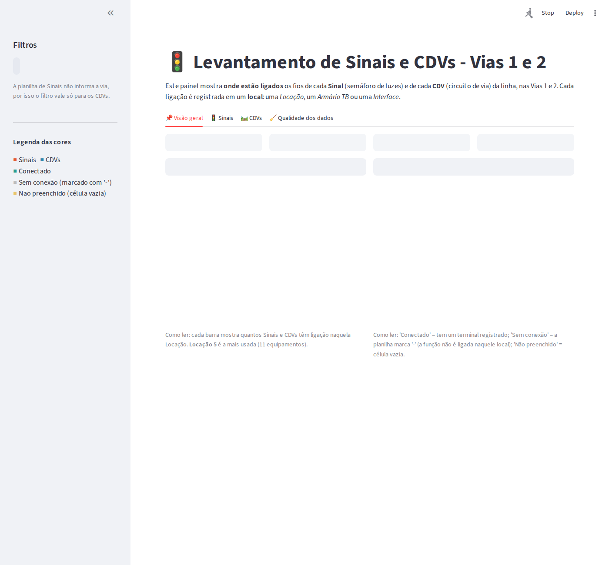
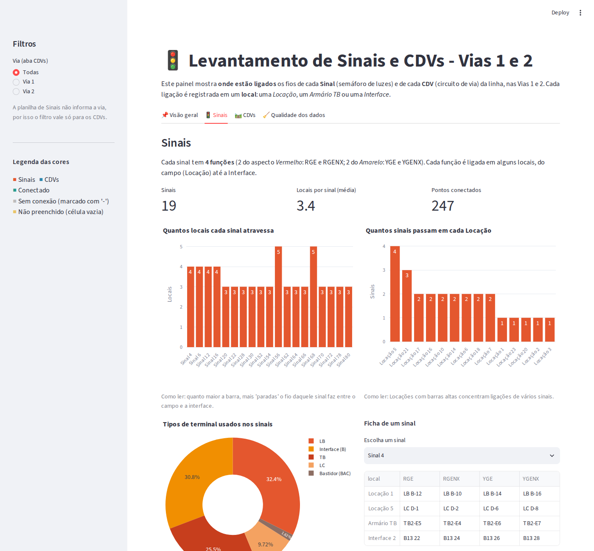
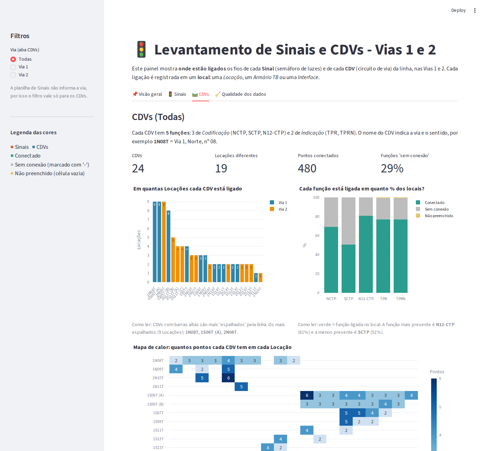

# 🚦 Dashboard de Sinais e CDVs – Vias 1 e 2

Dashboard interativo em **Streamlit** feito para o **Projeto Integrador 1** do curso de Tecnologia em Ciência de Dados (FATEC Cotia).

O projeto parte de duas planilhas de levantamento de equipamentos ferroviários (**Sinais** e **CDVs**, vias 1 e 2), faz a **limpeza e modelagem** dos dados e apresenta os resultados em gráficos simples e objetivos.



## 🎯 O que o dashboard mostra

| Aba | Conteúdo |
|---|---|
| 📌 Visão geral | Total de sinais e CDVs, Locações mais usadas e situação do preenchimento do levantamento |
| 🚦 Sinais | Quantos locais cada sinal atravessa, quantos sinais passam em cada Locação, tipos de terminal e ficha de cada sinal |
| 🛤️ CDVs | Em quantas Locações cada CDV está ligado, % de cada função ligada, mapa de calor CDV × Locação e filtro por via |
| 🧹 Qualidade dos dados | O que foi tratado, itens a conferir e download dos CSVs |

| Sinais | CDVs |
|---|---|
|  |  |

## 🗂️ Estrutura do repositório

```
.
├── app.py                  # dashboard em Streamlit
├── limpeza.py              # limpeza e modelagem das planilhas
├── requirements.txt
├── dados/
│   ├── levantamento_BD_Sinais_via_1_e_2.xlsx   # base original
│   ├── levantamento_BD_CDVs_via_1_e_2.xlsx     # base original
│   ├── sinais_tratado.csv                      # base tratada (260 linhas, 19 sinais)
│   ├── cdvs_tratado.csv                        # base tratada (677 linhas, 21 CDVs únicos em 24 blocos)
│   └── log_qualidade.csv                       # correções feitas e pontos a conferir
└── docs/                   # imagens do README
```

## ▶️ Como executar

```bash
git clone <URL-DO-SEU-REPOSITORIO>
cd <nome-da-pasta>

python -m venv .venv
source .venv/bin/activate        # Windows: .venv\Scripts\activate
pip install -r requirements.txt

python limpeza.py                # opcional: regenera os CSVs tratados
streamlit run app.py
```

O app abre em `http://localhost:8501`.

## 🧹 Limpeza e modelagem

As planilhas originais são feitas para leitura visual (blocos lado a lado e células mescladas). Para analisar, cada uma foi transformada em uma tabela em que **cada linha é um ponto de ligação**: equipamento + função + local + terminal.

1. Blocos reorganizados em uma única tabela por planilha.
2. Nomes de local padronizados (`Armario TB` e `Armários TB` → `Armário TB`).
3. Espaços extras removidos e códigos padronizados (`B0923` → `B09 23`; `BL B-11` → `LB B-11`).
4. Células com dois terminais (`A / B`) separadas em duas linhas.
5. Coluna `status` para diferenciar **Conectado**, **Sem conexão** (`-`) e **Não preenchido** (vazio).
6. Variáveis derivadas: via e sentido (a partir do nome do CDV, ex.: `1N08T` = Via 1, Norte), aspecto do sinal (Vermelho/Amarelo), tipo de local e prefixo do terminal.

### Dicionário de colunas

**`sinais_tratado.csv`**: `sinal`, `sinal_nome`, `funcao` (RGE, RGENX, YGE, YGENX), `aspecto`, `local`, `tipo_local`, `terminal`, `status`, `prefixo_terminal`, `terminal_suspeito`

**`cdvs_tratado.csv`**: `cdv`, `cdv_numero`, `via`, `sentido`, `funcao` (NCTP, SCTP, N12-CTP, TPR, TPRN), `grupo_funcao` (Codificação/Indicação), `local`, `tipo_local`, `terminal`, `status`, `prefixo_terminal`, `terminal_suspeito`

## ⚠️ Limitações e pontos a conferir

- `1S06T` aparece 2 vezes e `2S11T` 3 vezes na planilha original, com dados diferentes. Foram separados como (A), (B) e (C) pela ordem de leitura.
- Terminais fora do padrão foram mantidos como estão e marcados em `terminal_suspeito` (ex.: `TB-E59`, `TB2-29`, `B24`).
- No Sinal 30 o cabeçalho trazia `RGE` sem número; foi assumido `30RGE`.
- A planilha de Sinais não informa a via, então o filtro de via vale apenas para os CDVs.

## 🛠️ Tecnologias

Python · pandas · openpyxl · Plotly · Streamlit
